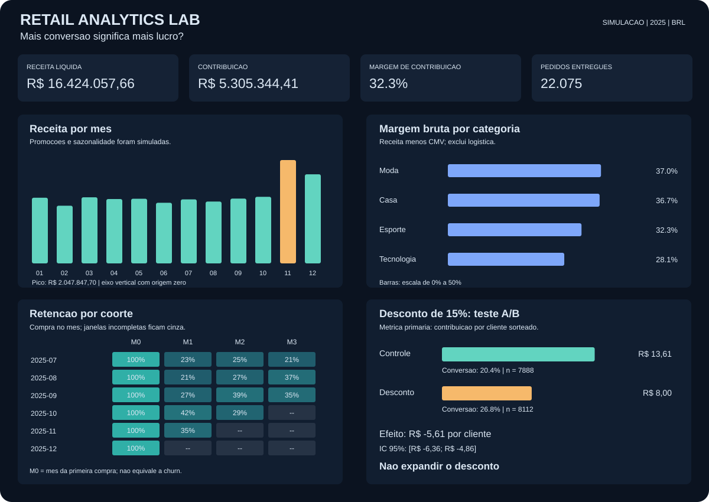

# Retail Analytics Lab

**Um desconto que aumenta a conversão também aumenta o resultado?**

Laboratório de análise de varejo com Python, SQL e estatística. Integra geração de dados simulados, validações, Data Warehouse local, indicadores, coortes, RFM e um experimento cujo critério de decisão é contribuição por cliente.

> **Dados integralmente simulados.** Este é um projeto de portfólio, desenvolvido com assistência de IA. Os números não são resultados de clientes ou de uma empresa real. O mecanismo do desconto está definido no gerador e serve para demonstrar o método.



## Resultado do cenário padrão

| Métrica | Controle | Desconto de 15% |
|---|---:|---:|
| Clientes sorteados | 7.888 | 8.112 |
| Conversão | 20,36% | 26,81% |
| Contribuição por cliente sorteado | R$ 13,61 | R$ 8,00 |

A conversão sobe **6,45 pontos percentuais**, mas a contribuição cai **R$ 5,61 por cliente sorteado**. IC 95% da diferença: **[−R$ 6,36; −R$ 4,86]**. Neste cenário, a decisão é **não expandir o desconto**. Consulte o [relatório executivo](reports/executive_summary.md) para premissas e limites.

O ponto do projeto é explicitar o caminho entre dados, métricas e decisão: um indicador de volume pode melhorar enquanto o resultado econômico piora.

## Executar

Recomendado: **Python 3.12**. Execute os comandos na raiz deste repositório.

```bash
git clone https://github.com/italoaraujo2205/retail-analytics-lab.git
cd retail-analytics-lab
python -m venv .venv
```

Ative o ambiente:

```powershell
# Windows PowerShell
.venv\Scripts\Activate.ps1
```

```bash
# Linux ou macOS
source .venv/bin/activate
```

Depois, em qualquer sistema:

```bash
python -m pip install -r requirements-lock.txt
python -m pip install -e . --no-deps
python -m retail_lab run
python -m unittest discover -s tests -v
```

Abra **`reports/report.html`** no navegador. O relatório funciona localmente, sem servidor, internet, chave de API ou banco externo. No GitHub, leia o [resumo em Markdown](reports/executive_summary.md); o site não executa o HTML do repositório.

Alternativa, com dependências já disponíveis: `PYTHONPATH=src python -m retail_lab run` em Linux/macOS. Os CSVs de origem e o SQLite são regenerados em `data/` e não são versionados. O snapshot de relatórios é versionado para permitir inspeção imediata.

## O que está implementado

- Histórico de 2025: 24.000 pedidos únicos, 6.000 clientes possíveis, 24 produtos, cancelamentos e devoluções.
- Contratos: esquema, valores, unicidade, referências e reconciliação. Vinte duplicatas idênticas intencionais são removidas com contagem auditável; duplicatas conflitantes interrompem o fluxo.
- Warehouse SQLite: dimensões de cliente/produto, fatos de pedido/item e marts em SQL. Valores dos fatos em centavos inteiros.
- Métricas: receita líquida, contribuição, ticket médio, margem bruta por categoria, retenção mensal e segmentos RFM.
- Experimento independente: 16.000 clientes, análise intention-to-treat, SRM, Welch e bootstrap por cliente.
- Relatório HTML/SVG, saídas CSV/JSON e notebook exploratório.
- Testes de regras de negócio e workflow de CI. Não há Airflow, Kafka ou cloud no runtime desta versão.

## Fluxo e organização

Dados simulados em CSV → validação e deduplicação em pandas → fatos e marts em SQLite/SQL → coortes e experimento em Python → relatório e resultados auditáveis.

| Caminho | Conteúdo |
|---|---|
| `src/retail_lab/generate.py` | Geração determinística do histórico e do experimento |
| `src/retail_lab/quality.py` | Contratos e rejeição de dados inválidos |
| `sql/warehouse.sql` | Grãos, fatos, índices e definição dos indicadores |
| `src/retail_lab/analysis.py` | Coortes e segmentos RFM com corte temporal |
| `src/retail_lab/experiment.py` | Estimativa do efeito e verificações do experimento |
| `src/retail_lab/report.py` | Relatórios HTML, SVG, Markdown, CSV e JSON |
| `notebooks/retail_decisions.ipynb` | Exploração guiada dos dados e resultados |
| `tests/` | Testes de qualidade, reconciliação, carga e análise |
| `reports/manifest.json` | Seeds, versões, janela e hashes das fontes |

## Notebook

Depois de instalar o projeto:

```bash
python -m pip install -e ".[notebook]"
jupyter lab
```

Abra `notebooks/retail_decisions.ipynb` e execute as células em ordem. A primeira célula de código aceita o notebook aberto na raiz ou em `notebooks/`. O notebook pode regenerar o snapshot com os mesmos parâmetros.

## Decisões e limites

**Grão antes do join:** agrego itens antes de acrescentar a logística do pedido para evitar fan-out. **Margens ponderadas:** calculo razão das somas, não média de margens individuais. **Coortes censuradas:** períodos incompletos ficam ausentes. **Métrica experimental:** todos os clientes sorteados entram no denominador.

O carregamento é uma reconstrução completa de snapshot, com substituição do banco somente após sucesso. É local e assume um único processo. Não implementa ingestão real, incremental, CDC, plataforma distribuída ou avaliação de escala. A amostra experimental é didática, sem cálculo de poder anterior. Não há inferência causal na série histórica. A contribuição exclui impostos, custos fixos e aquisição.

Leia o [contrato de dados e métricas](docs/data_dictionary.md), o [desenho experimental](docs/experiment_design.md) e o [roteiro de explicação do projeto](docs/interview_guide.md).

## Reproduzir outro cenário

```bash
python -m retail_lab run --seed 123 --orders 12000
```

Isso sobrescreve os dados locais e relatórios do cenário anterior. A seed controla a geração; o manifesto registra hashes das entradas. Versões diferentes de bibliotecas podem produzir diferenças numéricas: use as versões fixadas para comparar com o snapshot publicado. A seed alternativa também pode provocar reprovação no SRM, como esperado para uma checagem probabilística; investigue antes de interpretar a inferência.

## English overview

A reproducible retail analytics portfolio with synthetic data, Python/pandas/NumPy, SQL, data quality checks, cohort retention, RFM segmentation and a randomized discount simulation. The primary experimental outcome is contribution per randomized customer, including non-buyers. In the default scenario, conversion rises while contribution falls. This demonstrates analytical reasoning, not real-world commercial impact.
